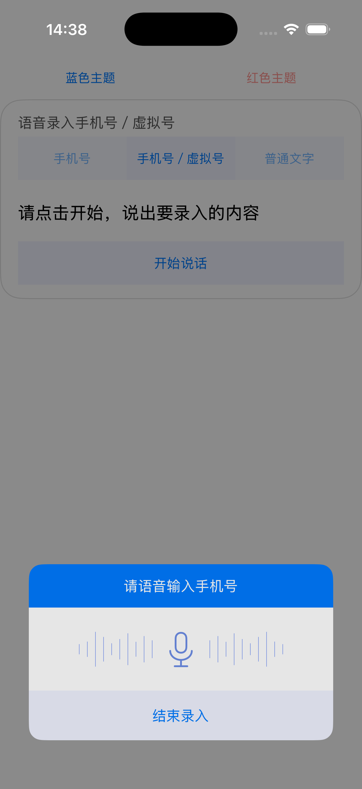
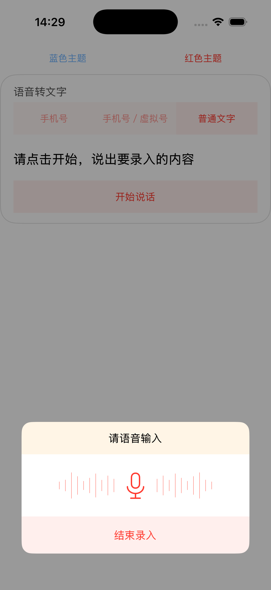

# 模拟器 UI 验收

环境：iPhone 17 Pro，iOS 26.4，arm64，竖屏。

## 构建与隔离

- 模拟器编译、安装、运行成功。
- `xcodebuild test` 通过：3 项测试，0 失败。
- 模拟器产物未复制 `iflyMSC.framework`；应用符号表中没有讯飞 `IFly` Objective-C 类。
- 真机 arm64 目标构建通过，继续使用原有讯飞 SDK。
- SPM 依赖图检查通过：`EASYIFLY_SIMULATOR=1` 时仅包含 EasyIFly；默认仍包含 iflyMSC。

## 自动测试

1. 尚未开始或已经停止的模拟会话忽略注入文本。
2. 不匹配的文本继续等待；匹配后只回调一次；新会话可以再次识别。
3. 虚拟号经过原有过滤格式化后回调，移除弹层并且仅触发一次关闭回调。

## 界面操作

- 蓝色与红色主题：标题、波形、麦克风及结束按钮配色正常。
- 弹层布局、圆角和底部安全区域正常，未观察到文字截断或控件重叠。
- 手机号、手机号／虚拟号、普通文字模式切换正常；文字模式标题为“请语音输入”。
- 点击“结束录入”后遮罩与弹层一起消失。
- 点击弹层外的遮罩可以关闭，页面恢复交互。
- 五帧波形显示正常；SDK 预览分支不录音、不请求网络。

本次验收范围为上述模拟器与竖屏布局；未进行真机录音和网络识别验收。
